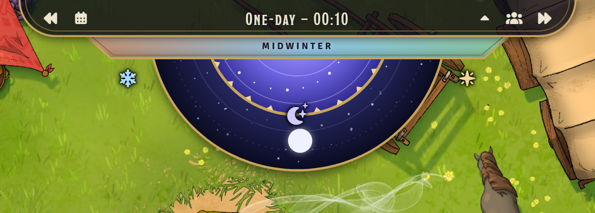
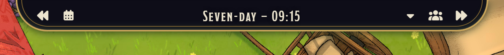

# Simple D&D Calendar

A new look for D&D 5e's calendar on Foundry VTT.

A framed bar hangs from the top of the screen with the day and the time between the buttons. Beneath it, a band of
the year's seasons slides by under the date, and a bowl of night sky holds a day wheel that turns through the day,
with the moons waxing and waning as they cross it.



<sub>Battlemap: [Caravan Camp (Grasslands)](https://www.czepeku.com/fantasy/maps/caravan-camp/grasslands) by
Czepeku, [www.czepeku.com](https://www.czepeku.com).</sub>

## What It Shows

- **The bar.** The day of the week and the time, in the time format you picked in D&D 5e's calendar preferences.
- **The season band.** The date, written across a band of the year's colours (green spring, gold summer, orange
  autumn, icy winter) that slides along as the year goes by, so you can see how far into the season you are. Hover
  it for the season's name.
- **The season's trim.** The frame is dressed for the season along the bar's edge and the bowl's rim: frost and
  icicles in winter, a flowering vine in spring, sunflowers in summer, and fallen leaves in autumn. Off by default;
  the GM can turn it on for everyone under **Dress the Frame for the Season**.
- **The day wheel.** Half day, half night. It turns through the day: the day half comes round from the right in
  the morning, sits at the bottom at noon, and leaves to the left in the evening. The icon on its rim shows dawn,
  day, dusk or night.
- **The moons.** Each moon of the world's calendar rides the bowl while it's up, showing its phase. A full moon rides
  highest at midnight; a new moon keeps company with the sun. Hover one for its name and phase.
- **Festivals** are marked beside the bowl, such as Midwinter or Needfest.


### Moons

| Calendar | Moons |
| --- | --- |
| Calendar of Harptos (Forgotten Realms) | Selûne, every 30 days and 10½ hours |
| Calendar of Greyhawk | Luna (28 days) and Celene (91 days), both full on Needfest 4 |
| Calendar of Khorvaire (Eberron) | All twelve moons, from Zarantyr (28 days) to Vult (105 days) |
| Gregorian | The Moon |

## Driving Time

The GM has the time controls at either end of the bar, as D&D 5e's own calendar does:

- **Rewind** and **Advance** step back or forward an hour. Hover either for a drop-down of steps from a minute to a
  week.
- **Set Date** opens D&D 5e's dialog to jump to a date.
- A change of time **plays out**: the clock runs, the wheel turns and the moons move, taking longer for longer jumps.
  Turn this off under **Animate Time Changes** if you'd rather it jumped.


Players get buttons for their character sheet and the party sheet. The **caret** beside them hides the sky, leaving
just the bar, and the calendar remembers this for each player.



## Installing

In Foundry's setup screen, go to **Add-on Modules → Install Module**, paste this manifest URL into **Manifest URL**
and click **Install**:

```
https://github.com/IainFielding/simple-dnd-calendar/releases/latest/download/module.json
```

Then turn on **Simple D&D Calendar** under **Manage Modules** in a D&D 5e world.

## Setting Up

The module uses D&D 5e's calendar, so the calendar, the date and time formats, and daily recovery as time passes all
work as the system's own calendar does. Its settings are under **Game Settings → Configure Calendar**.

- **Turning it on.** D&D 5e's calendar starts turned off. The first time a GM loads the world with this module, it
  offers to turn it on.
- **Which calendar.** Whichever the GM picks in D&D 5e's calendar settings: Harptos, Greyhawk, Khorvaire or
  Gregorian. The module never changes it.
- **Hiding it.** Each player can hide the calendar with D&D 5e's **Display Calendar HUD** preference.

Other modules' calendar buttons, added with D&D 5e's `dnd5e.prepareCalendarButtons` hook, appear in the bar too.

### Long Summer Days

Turn on **Long Summer Days** and sunrise and sunset move with the seasons: sixteen hours of daylight at midsummer
and eight at midwinter. The longest day falls halfway between the start of spring and the start of autumn, which
is the summer solstice on the Calendar of Harptos. The day half of the wheel grows and shrinks to match, and as the
module changes the calendar's own sunrise and sunset, D&D 5e's dawn and dusk recovery follows too.

### Darkness

Turn on **Darken Scenes at Night** and the active scene's darkness follows the sun: dark at night, light by day,
darkening through the hour after sunset and lightening through the hour before sunrise. Only the active scene is
changed, and a scene with its darkness locked in its lighting settings is left alone.

### Settings

| Setting | Default | |
| --- | --- | --- |
| Animate Time Changes | On | Play a change of time out on the calendar, rather than jumping straight to it. Each player picks for themselves. |
| Dress the Frame for the Season | Off | Trim the frame for the season. The GM picks, for everyone. |
| Long Summer Days | Off | Move sunrise and sunset with the seasons. The GM picks. |
| Darken Scenes at Night | Off | Keep the active scene's darkness in step with the sun. The GM picks. |

## For Developers

Moons are kept by calendar, keyed as in `CONFIG.DND5E.calendar.calendars`. Change them, or add moons for your own
calendar, in the `sogrom-simple-dnd-calendar.moons` hook, which runs once before the calendar first draws:

```js
Hooks.on("sogrom-simple-dnd-calendar.moons", (moons, calendar) => {
  moons.myCalendar = [{
    id: "pale", name: "The Pale Lady", period: 32, color: "#e8f0ff",
    epoch: { year: 1000, day: 0 }, // A moment its phase is known: a year as the calendar shows it, a day of that year from 0
    epochPhase: 0.5                 // ...and its phase then: 0 new, 0.5 full
  }];
});
```

The calendar itself is `dnd5e.ui.calendar`, a subclass of D&D 5e's `CalendarHUD`.

## Compatibility

Foundry VTT 14 and D&D 5e 6.x.

## Credits

Battlemaps by Czepeku — [www.czepeku.com](https://www.czepeku.com). The battlemap behind the calendar in the screenshots is [Caravan Camp (Grasslands)](https://www.czepeku.com/fantasy/maps/caravan-camp/grasslands) and is not distributed in this the module.

## Licence

[MIT](LICENSE).
