# Simple D&D Calendar

Simple D&D Calendar turns the standard D&D 5e calendar into a living part of your game world. A decorative calendar bar sits across the top of the screen, showing the current day and time while an animated sky tracks the passage of the day, the changing seasons, festivals, and moon phases.

Watch the sun rise and set, see moons wax and wane, and follow the progress of the year at a glance without opening a separate calendar window.

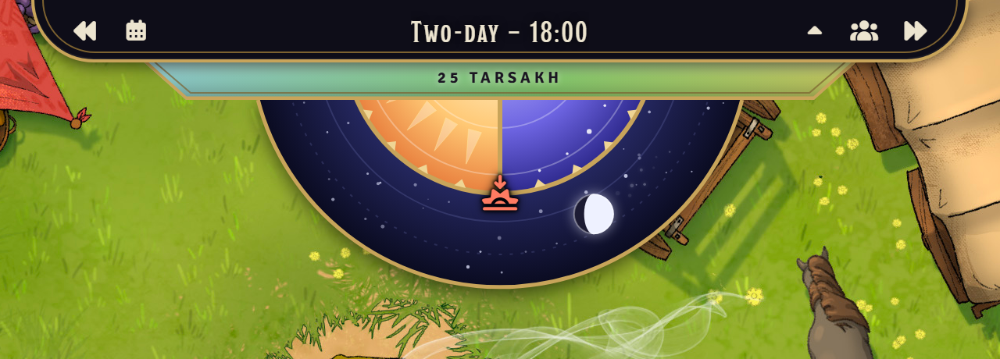

## Features

### Calendar Bar

A framed calendar bar hangs from the top of the screen, displaying the current day and time while keeping the calendar close at hand. GMs can control the flow of time directly from the bar, and buttons added by other modules appear alongside the built-in controls.

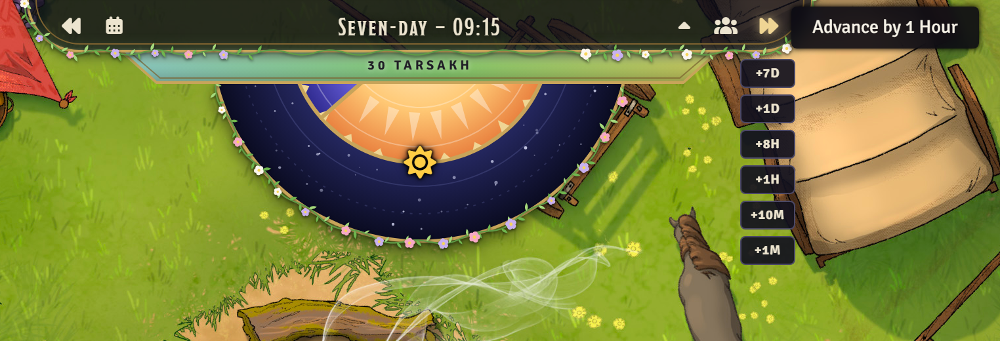

### Seasonal Timeline

Beneath the date, a band of seasonal colours slides gently through the year, showing progress from spring to summer, autumn, and winter. Hovering over the timeline reveals the current season, the phases of the world's moons, and when each moon will next be full.

### Animated Day Wheel

At the heart of the display is an animated day wheel that tracks the passage of time. Dawn rises in the east, sunlight reaches its peak at noon, and evening gradually gives way to night as the wheel turns through the day. Clear visual indicators make it easy to see the current phase of the day at a glance, from first light to deepest night.

| Noon in spring | Dusk at the end of summer |
| --- | --- |
| 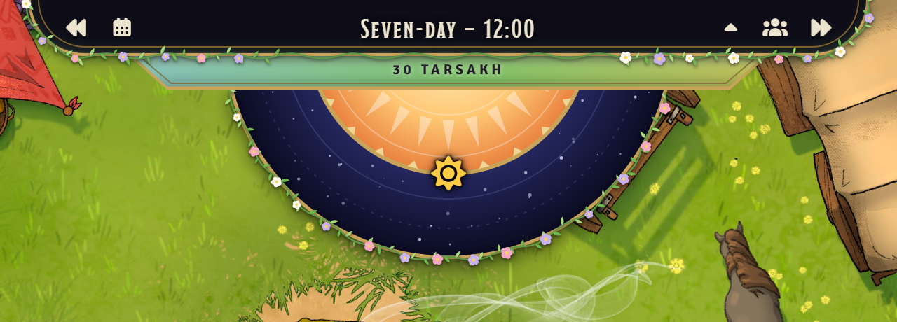 | 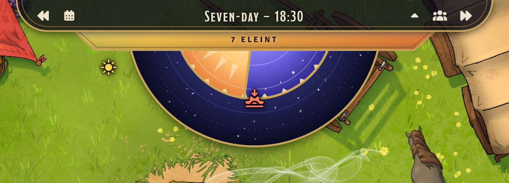 |

### Moon Tracking

The moons of the active calendar travel across the sky as time passes, each displaying its current phase. Full moons climb high overhead at midnight, new moons remain close to the sun, and every phase in between is represented. Hover over a moon to learn its name and current phase.

| Selûne full over the Forgotten Realms | Luna and Celene full together on Oerth| Eberron's twelve moons |
| --- | --- | --- |
| 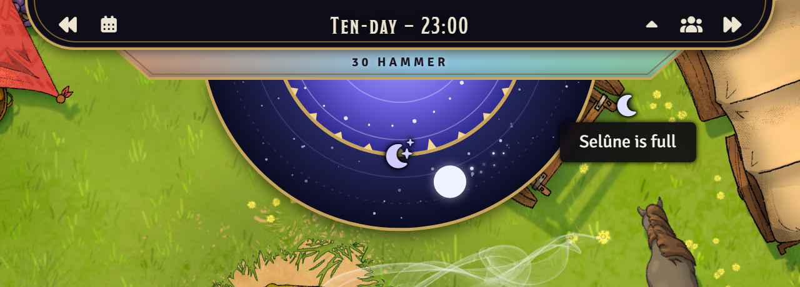 | 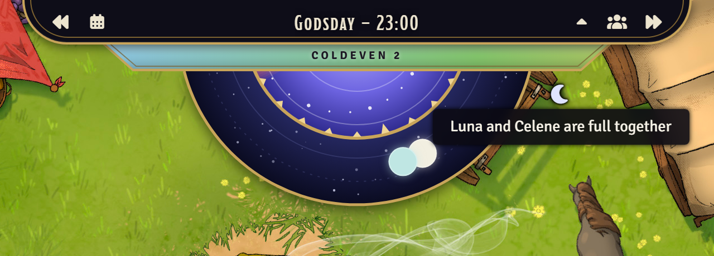 | 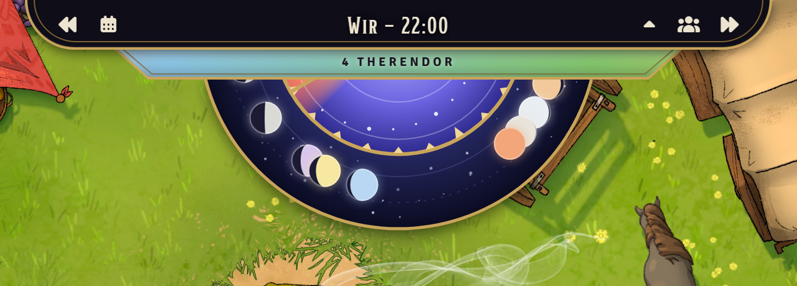 |

### Festivals and Lunar Events

The calendar marks the great festivals of the year alongside celestial events such as full moons, new moons, and notable lunar alignments. Whether the party is gathering for Greengrass, celebrating Midsummer, giving thanks at Highharvestide, enduring the depths of Midwinter, honouring the Feast of the Moon, or welcoming the rare Shieldmeet, the calendar keeps the changing seasons and skies close at hand.

To reflect the passage of the year, festival days can also bring subtle seasonal decorations to the sky and calendar. Midwinter and Needfest are marked with holly and bells, Greengrass and Growfest with fresh grass and daisies, Midsummer and Richfest with lanterns, Shieldmeet with banners and shields, Highharvestide and Brewfest with wheat and apples, and the Feast of the Moon with moonflowers and silver crescents.

| Greengrass | Midsummer | Highharvestide |
| --- | --- | --- |
| 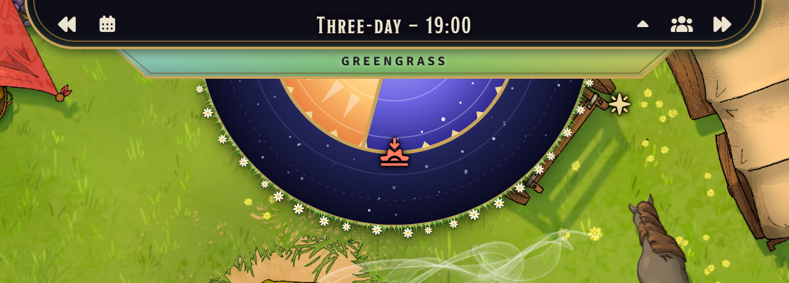 | 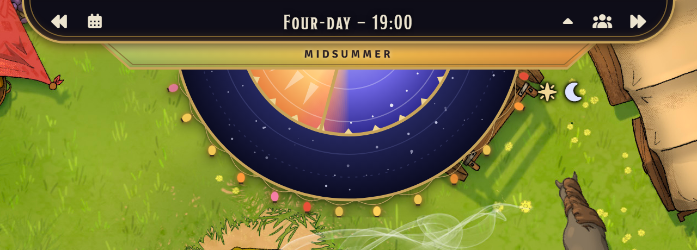 | 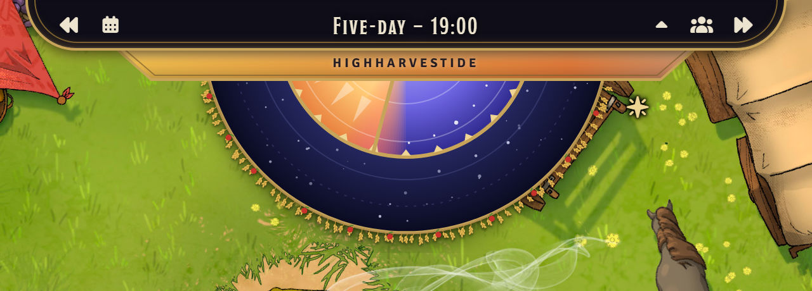 |
| **Midwinter** | **Feast of the Moon** | **Shieldmeet** |
| 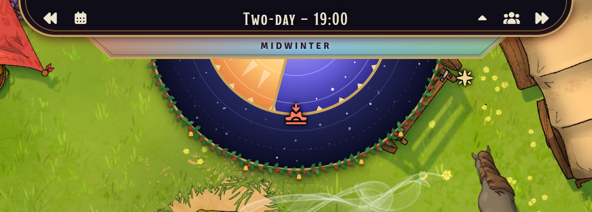 | 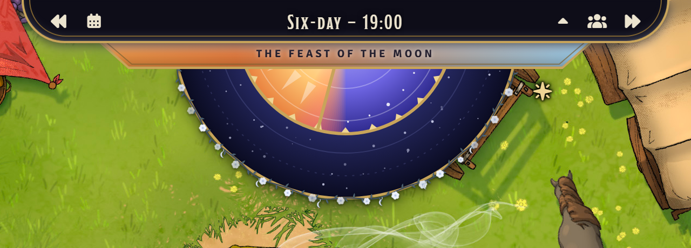 | 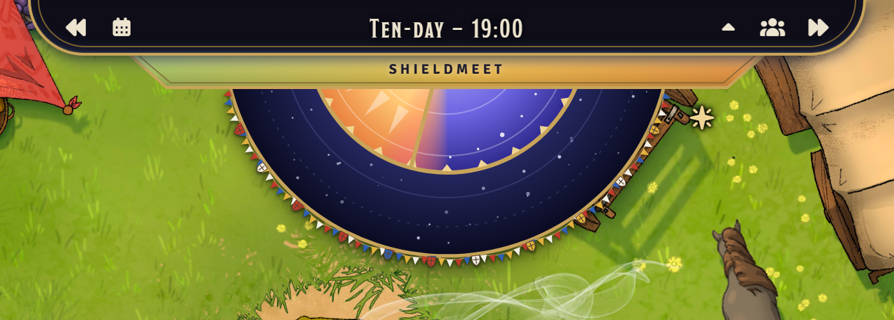 |

### Seasonal Decorations

The sky surrounding the day wheel can be dressed to reflect the changing seasons. Winter brings frost and icicles, spring is adorned with flowering vines, summer blooms with bright sunflowers, and autumn scatters fallen leaves across the frame.

| Winter | Spring |
| --- | --- |
| 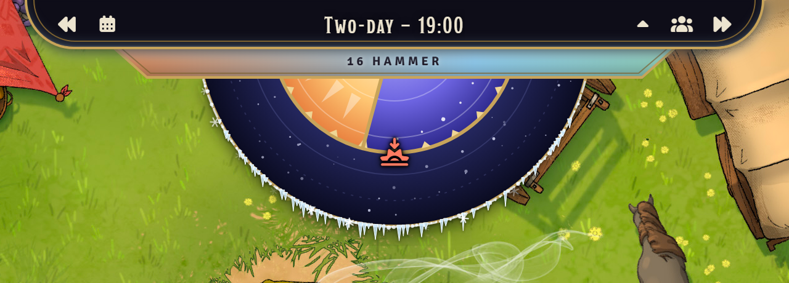 |  |
| **Summer** | **Autumn** |
| 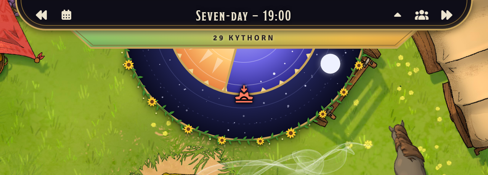 | 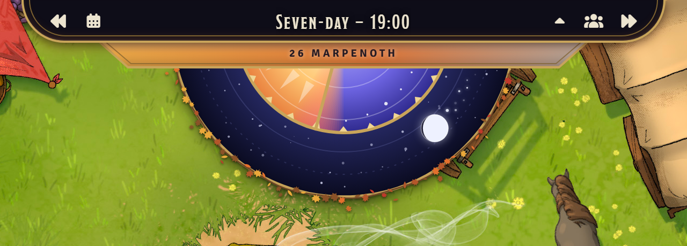 |


### Adventure Themes

The calendar bar can be tailored to suit the setting of your campaign. From the gothic dread of *Curse of Strahd* and the icy wilderness of *Rime of the Frostmaiden* to the infernal battlefields of *Descent into Avernus* and the reality-shattering threat of *Vecna: Eve of Ruin*, themed trims help the calendar blend seamlessly into your adventure.

Every adventure and campaign setting Wizards of the Coast has published for fifth edition has a theme, 48 in all, from *Lost Mine of Phandelver* to *Arcana Unleashed*, and the worlds they're set in: the Forgotten Realms, Eberron, Exandria, Ravnica, Theros, Strixhaven, Spelljammer, Dragonlance, Planescape and more. Each brings its own visual identity, allowing the calendar to complement the stories unfolding at your table. The [GM's guide](docs/gm.md#adventure-trims) lists them all.

| Curse of Strahd | Rime of the Frostmaiden | Descent into Avernus |
| --- | --- | --- |
| 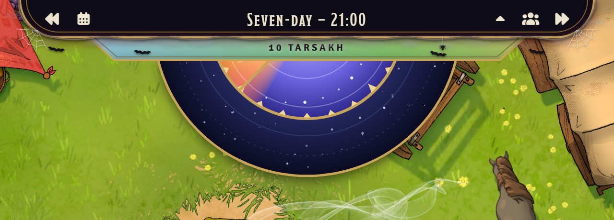 | 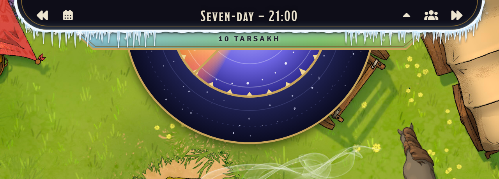 | 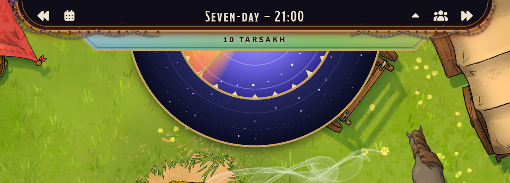 |
| **Forgotten Realms** | **Eberron** | **Spelljammer** |
| 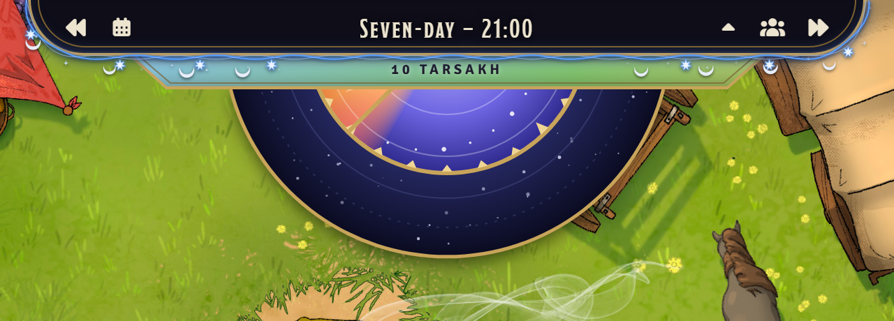 | 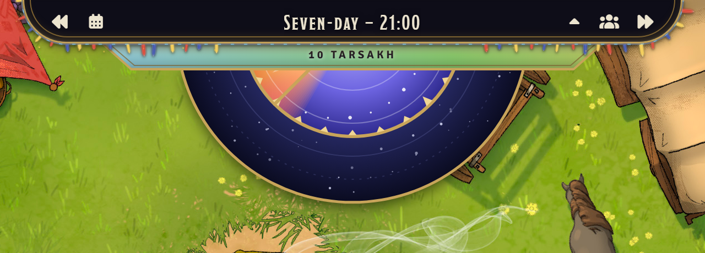 | 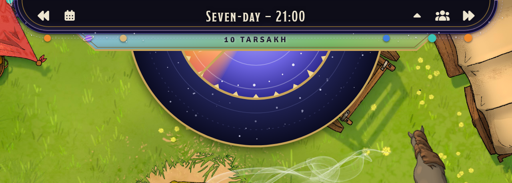 |

### Darkness

The world grows darker as the sun sinks below the horizon. The active scene follows the cycle of day and night, fading gradually through sunset and twilight before reaching full darkness after nightfall.

The transition mirrors the movement of the sun rather than changing abruptly. Bright daylight gives way to the softer light of late afternoon, then to dusk, twilight, and finally night. As dawn approaches, the process reverses and daylight slowly returns.

Moonlight can soften the darkness after sunset. A bright full moon riding high in the sky leaves the scene noticeably brighter than a moonless night, helping the world feel connected to the celestial events displayed by the calendar.


## Installing

In Foundry's setup screen, go to **Add-on Modules → Install Module**, paste this manifest URL into **Manifest URL**
and click **Install**:

```
https://github.com/IainFielding/simple-dnd-calendar/releases/latest/download/module.json
```

Then turn on **Simple D&D Calendar** under **Manage Modules** in a D&D 5e world.

## Compatibility

Foundry VTT 14 and D&D 5e 6.x.

## Credits

The battlemap behind the calendar in the screenshots is [Caravan Camp (Grasslands)](https://www.czepeku.com/fantasy/maps/caravan-camp/grasslands) and is not distributed with the module.

For more of Czepeku's work, visit https://www.czepeku.com. 

## Licence

[MIT](LICENSE).
