# Trims and Styles

Every way to dress the calendar, with a picture of each. The GM picks the trims, for everyone, and each player picks the style, for their own screen, in **Game Settings → Configure Settings → Simple D&D Calendar**. A bar trim and a sky trim can be used together.

- [Bar trims](#bar-trims): one for each adventure and setting
- [Sky trims](#sky-trims): the seasons, and festival days
- [Styles](#styles): how the calendar itself looks

## Bar trims

**Dress the Bar for Your Adventure** trims the bar's lower edge for the adventure you're running, or the world it's set in. Every D&D adventure and campaign setting Wizards of the Coast has published for fifth edition has one, and there's one for World of Warcraft: 49 in all, listed here as they are in the setting, in order of name. Where a setting and its adventures share a world, they share a trim.

The pictures show the bar with the sky open. The trim runs the whole length of the bar, but its middle, over the date, is left bare while the sky shows; collapse the sky and the trim runs unbroken.

[A](#acquisitions-incorporated) · [B](#bigby-presents-glory-of-the-giants) · [C](#candlekeep-mysteries) · [D](#descent-into-avernus) · [E](#eberron) · [F](#forgotten-realms) · [G](#ghosts-of-saltmarsh) · [H](#heroes-of-the-borderlands) · [J](#journeys-through-the-radiant-citadel) · [K](#keys-from-the-golden-vault) · [L](#locathah-rising) · [N](#netheril) · [O](#out-of-the-abyss) · [P](#phandelver-and-below-the-shattered-obelisk) · [Q](#quests-from-the-infinite-staircase) · [R](#ravnica) · [S](#scions-of-elemental-evil) · [T](#tales-from-the-yawning-portal) · [U](#uni-and-the-hunt-for-the-lost-horn) · [V](#vecna-eve-of-ruin) · [W](#waterdeep-dragon-heist)

### Acquisitions Incorporated

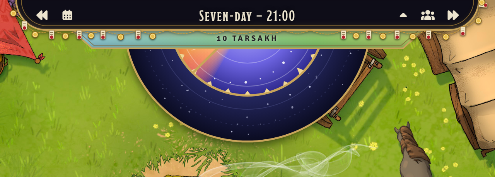

A brass chain in swags, hung with gold coins and contracts under red wax seals.

### Arcana Unleashed

A ley line, glowing runes, turning arcane circles, and sparkles.

### Arcana Unleashed: Deadfall

Thay's crimson silk, hung with gold tassels, daggers, and red sigils.

### Astarion's Book of Hungers

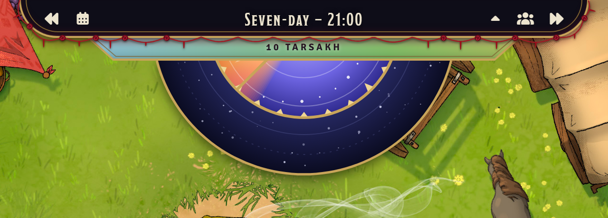

Crimson silk in swags, dark roses at its pins, and blood dripping from it.

### Bigby Presents: Glory of the Giants

Stone tablets carved with giant runes, glowing frost and fire.

### The Book of Many Things

The Deck's cards on a purple cord, each with its mark, and stars between.

### Candlekeep Mysteries

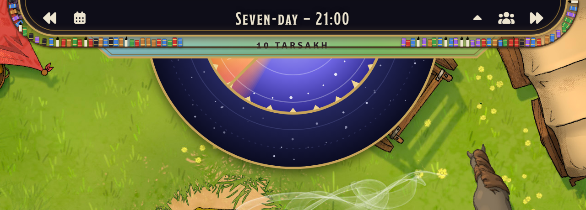

A shelf of books in a row, with candles among them.

### Curse of Strahd and Ravenloft

A dead, thorny vine, cobwebs in the corners, a spider, bats, and drifting mist. Also for *Van Richten's Guide to Ravenloft* and *Ravenloft: The Horrors Within*.

### Descent into Avernus

A hellish glow, iron spikes, hanging chains, and rising embers.

### Dragon Delves

A dragon's hoard of coins over the edge, gems of every dragon's colour, and claws gripping it.

### Dragon of Icespire Peak

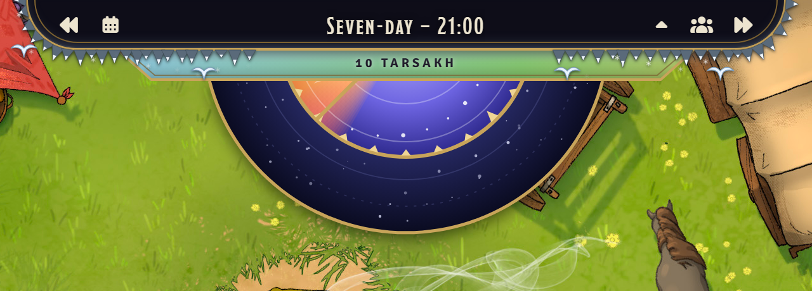

Snow-capped peaks, the white dragon wheeling, and falling snow.

### Dragonlance

Krynn's three moons, white, red and black, and silver lances between them. Also for *Shadow of the Dragon Queen*.

### Dragons of Stormwreck Isle

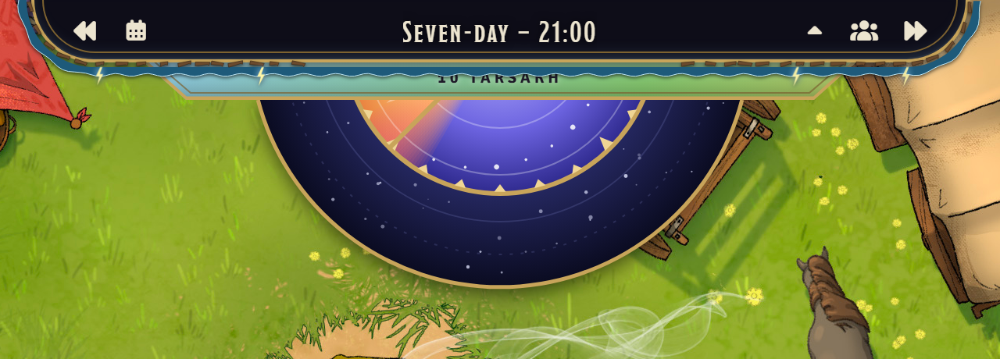

A wreck's broken timbers, the sea beneath, and lightning.

### Dungeon of the Mad Mage

Undermountain's brick, Halaster's turning rune gates, and arcane motes.

### Eberron

The lightning rail, and dragonshards of Siberys, Eberron and Khyber. Also for *Rising from the Last War*, *Forge of the Artificer* and *Forgotten Relics*.

### Exandria

Catha and Ruidus strung on silver, and the swirling sigils and motes of dunamis. Also for *Explorer's Guide to Wildemount*, *Call of the Netherdeep* and *Tal'Dorei Campaign Setting Reborn*.

### Forgotten Realms

The Weave as a blue ribbon, Mystra's seven-pointed stars, and Selûne's crescents. Also for *Sword Coast Adventurer's Guide*, *Heroes of Faerûn* and *Adventures in Faerûn*.

### Ghosts of Saltmarsh

Waves, a fishing net in swags, and shells caught in it.

### Greyhawk

Castle battlements, with lanterns lit beneath the merlons. Also for the setting in the 2024 *Dungeon Master's Guide*.

### Heroes of the Borderlands

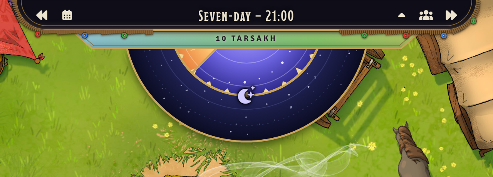

The Keep's palisade of sharpened stakes, with round shields hung on it.

### Hoard of the Dragon Queen

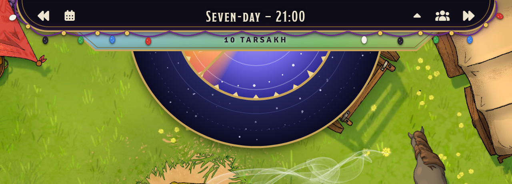

The Cult of the Dragon's purple in swags, with dragon eggs and spilled coins.

### Hold Back the Dead

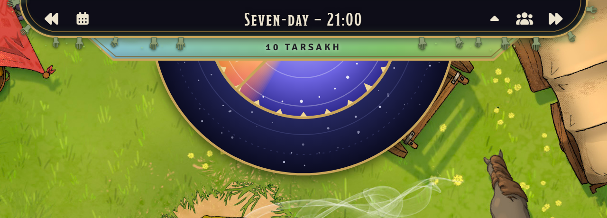

A grave's mist, and the dead's hands reaching out of it.

### Journeys through the Radiant Citadel

Concord jewels of every colour on a gold chain, shining.

### Keys from the Golden Vault

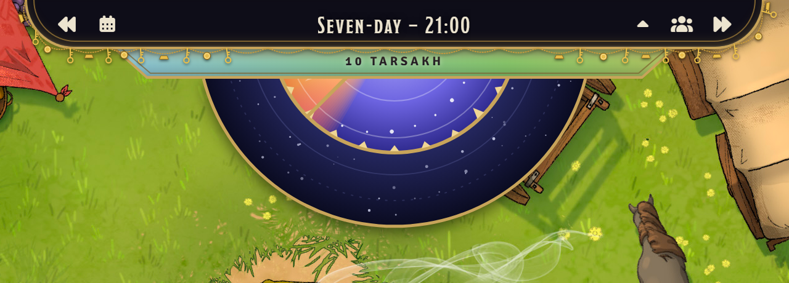

A gold chain hung with keys, gold bars and coins.

### Locathah Rising

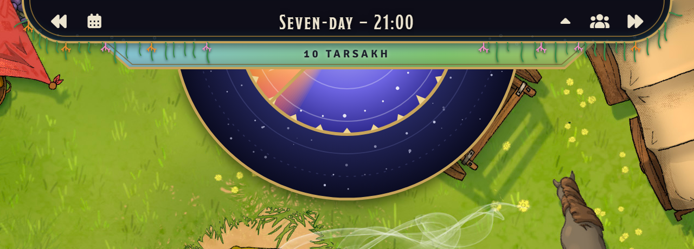

Kelp, coral, and rising bubbles.

### Lorwyn-Shadowmoor

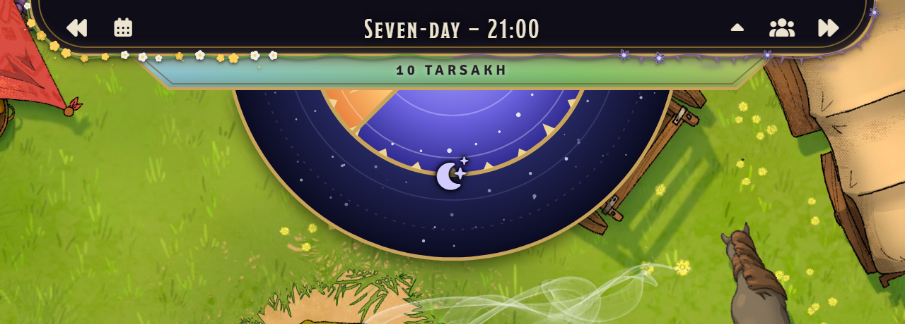

Lorwyn's sunlit flowers along one half, giving way to Shadowmoor's thorns and gloom. Also for *Lorwyn: First Light*.

### The Lost Laboratory of Kwalish

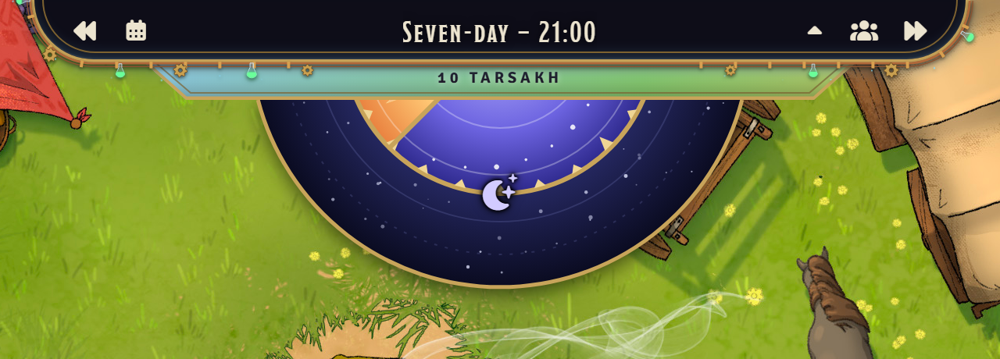

Copper pipes, turning gears, and glowing vials.

### Lost Mine of Phandelver

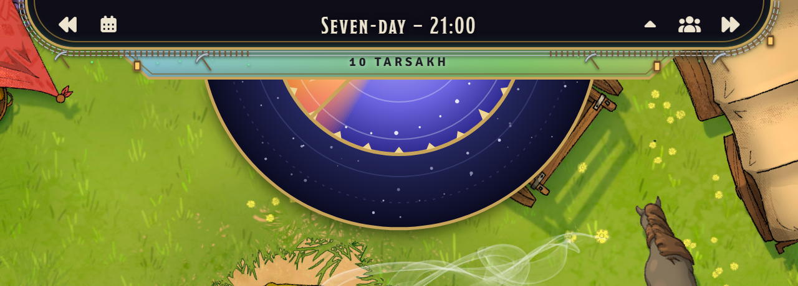

A mine's rails, pickaxes and lanterns, and Wave Echo Cave's green glow.

### Netheril

Floating enclaves crowned with towers, and the gold rings of their mythallars. Also for *Netheril's Fall*.

### Out of the Abyss

Stalactites, glowing fungus, and the violet motes of faerzress.

### Phandelver and Below: The Shattered Obelisk

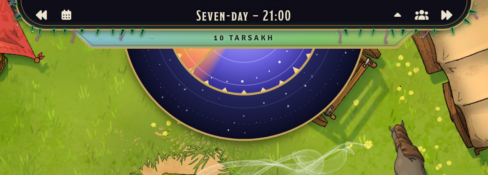

Dark shards of the obelisk, aberrant tentacles, and a sickly glow.

### Planescape

Razorvine with leaves like blades, and glowing portals. Also for *Sigil and the Outlands*, *Morte's Planar Parade* and *Turn of Fortune's Wheel*.

### Princes of the Apocalypse

The four elements in turn: air, earth, fire and water.

### Quests from the Infinite Staircase

A stair climbing along the edge, and doors to other worlds.

### Ravnica

Stained glass in the ten guilds' colours, and city spires. Also for *Guildmasters' Guide to Ravnica*.

### Rime of the Frostmaiden

A thick crust of snow, long icicles, and falling snow.

### The Rise of Tiamat

Scales in the five colours of the Dragon Queen's heads, and claws hooked over the edge.

### Scions of Elemental Evil

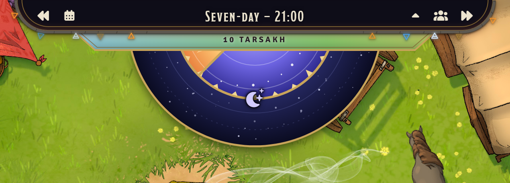

The Temple's cracked stone, and the alchemists' signs of the four elements, burning.

### Spelljammer

Wildspace, with orbits, planets ringed and plain, and the stars. Also for *Astral Adventurer's Guide*, *Boo's Astral Menagerie* and *Light of Xaryxis*.

### Storm King's Thunder

Storm clouds, lightning, and driving rain.

### Strixhaven

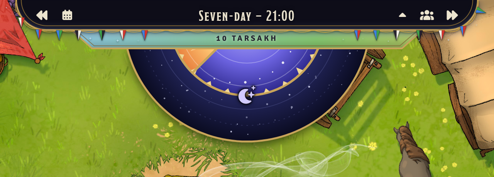

The five colleges' pennants on a gold cord. Also for *Strixhaven: A Curriculum of Chaos*.

### Tales from the Yawning Portal

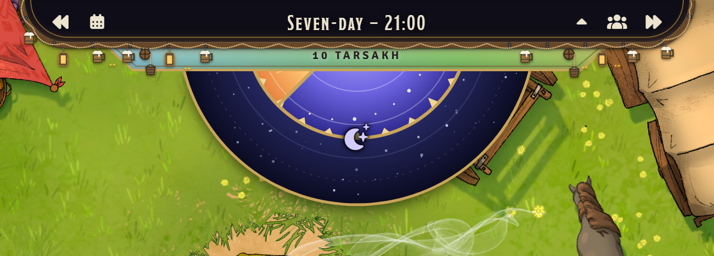

The taproom's iron-strapped beam, with rope, tankards and lanterns hung from it, a winch at each end lowering a bucket into the well, and eyes watching from the dark of Undermountain.

### Theros

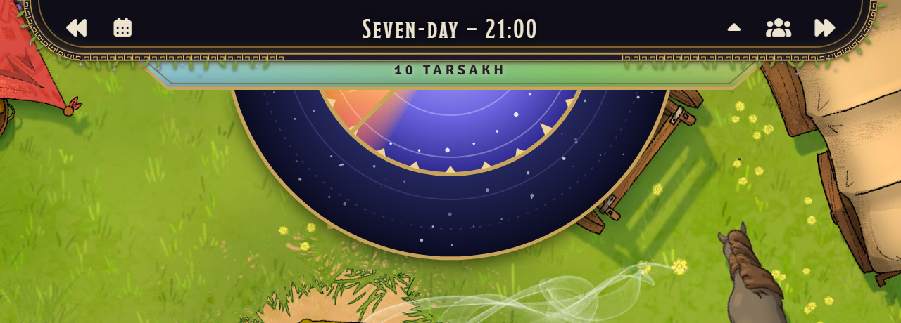

A gold meander, laurel leaves, and the stars of Nyx. Also for *Mythic Odysseys of Theros* and *Theros: No Silent Secret*.

### Tomb of Annihilation

Jungle leaves and lianas, bright flowers, and skulls. Also for *The Tortle Package*.

### Uni and the Hunt for the Lost Horn

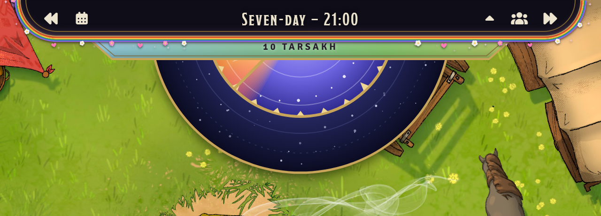

A rainbow, flowers, hearts and sparkles.

### Vecna: Eve of Ruin

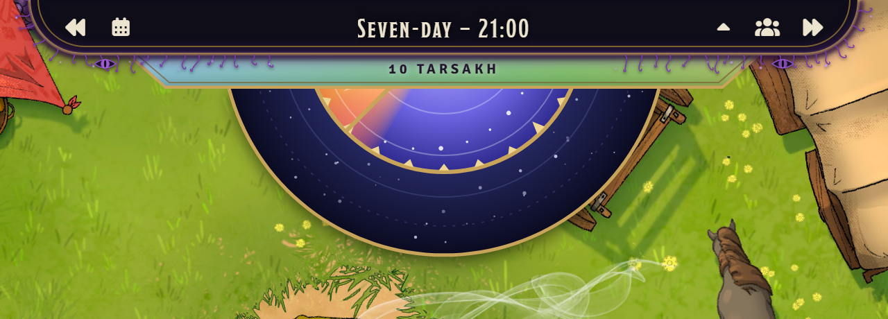

A gloom, necrotic tendrils, and the Eye, watching.

### Waterdeep: Dragon Heist

A velvet swag hung with the Masked Lords' masks, and gold dragons.

### The Wild Beyond the Witchlight

Curling ribbons, toadstools, sparkles, and fireflies.

### World of Warcraft

Riveted bronze plates set with gems, with claws between them.

## Sky trims

**Dress the Sky for the Season** trims the rim of the sky round the day wheel. **Follow the Seasons** changes with the year, and dresses festival days for the festival; **Just Winter**, **Just Spring**, **Just Summer** or **Just Autumn** keeps one season's trim all year.

### Seasons

| Winter | Spring |
| --- | --- |
|  |  |
| Frost and icicles | Flowering vines |
| **Summer** | **Autumn** |
|  |  |
| Sunflowers | Fallen leaves |

### Festivals

While the sky follows the seasons, a festival day is dressed for the festival. Festivals of the same kind in different calendars share a trim.

| Trim | Harptos | Greyhawk | Exandria | What it adds |
| --- | --- | --- | --- | --- |
| Midwinter | Midwinter | Needfest | Winter's Crest | Holly and bells |
| Greengrass | Greengrass | Growfest | Renewal Festival | Fresh grass and daisies |
| Midsummer | Midsummer | Richfest | Zenith | Lanterns |
| Shieldmeet | Shieldmeet | | | Banners and shields |
| Harvest | Highharvestide | Brewfest | Harvest's Close | Wheat and apples |
| Feast of the Moon | Feast of the Moon | | | Moonflowers and silver crescents |

| Midwinter | Greengrass | Midsummer |
| --- | --- | --- |
|  |  |  |
| **Shieldmeet** | **Harvest** | **Feast of the Moon** |
|  |  |  |

## Styles

**Calendar Style** is each player's own choice, for their own screen.

| Gilded Night | Parchment | Underdark |
| --- | --- | --- |
| 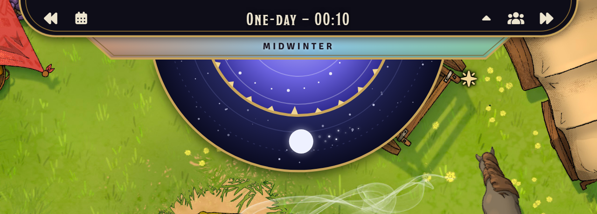 | 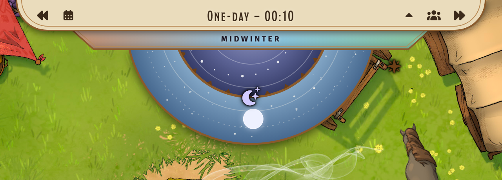 | 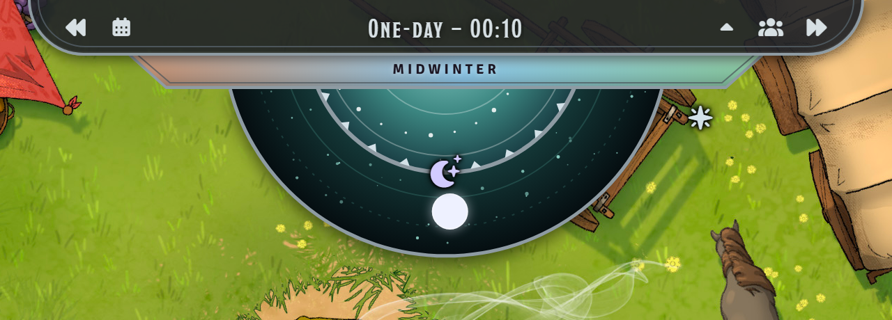 |
| Gold on a night sky. The default. | Bronze and ink on parchment. | Steel on Underdark stone. |
